<p align="center">
  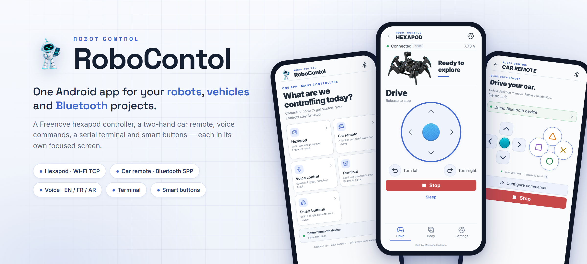
</p>

<p align="center">
  <a href="https://github.com/Marwane-Haddane/RoboControl-mobileApp/releases/latest"></a>
  <a href="#install-in-two-minutes"></a>
</p>
<p align="center">
  
  
  
  
  
  
  <a href="LICENSE"></a>
</p>
<p align="center">
  <a href="#robocontol-in-one-minute">Overview</a> ·
  <a href="#install-in-two-minutes">Install</a> ·
  <a href="#the-five-controllers">Controllers</a> ·
  <a href="#connect-to-the-freenove-hexapod">Hexapod setup</a> ·
  <a href="#how-it-works">How it works</a> ·
  <a href="#build-from-source">Build</a> ·
  <a href="#verification">Tests</a>
</p>

---

## RoboContol in one minute

Every robot project ends up with its own throwaway remote: one app for the hexapod, another for the Bluetooth car, a serial terminal for debugging, something else for the lights. **RoboContol puts them in one Android app.** Choose what you want to control, connect with the matching transport, and get only the controls that make sense for that device.

| You want to… | Open | It talks over |
| --- | --- | --- |
| Walk, turn and pose a **Freenove hexapod** | **Hexapod** | The robot's own Wi-Fi, raw TCP |
| Drive an Arduino / ESP32 **car** with a gamepad layout | **Car remote** | Bluetooth Classic (SPP) |
| Speak a command in English, French or Arabic | **Voice control** | Bluetooth Classic (SPP) |
| Type commands and watch the replies | **Terminal** | Bluetooth Classic (SPP) |
| Build a panel of ON/OFF buttons for a project | **Smart buttons** | Bluetooth Classic (SPP) |

> Every screenshot in this README is the real app UI (`native.html`, the same bundle shipped inside the APK), captured with the built-in **demo device** so no hardware is needed to explore it.

## Install in two minutes

**[⬇ Download the latest APK](https://github.com/Marwane-Haddane/RoboControl-mobileApp/releases/latest)**

1. Open the [latest release](https://github.com/Marwane-Haddane/RoboControl-mobileApp/releases/latest) on your Android phone and download **`RoboContol-<version>-android.apk`** from *Assets*.
2. Open the downloaded file. If Android asks, allow your browser or file manager to **install unknown apps**, then go back and tap **Install**.
3. Open RoboContol and pick a controller. To try it without hardware, tap **Connect a Bluetooth device → Show demo device**.

This is a sideloaded APK, not a Google Play release. Release builds are **debug-signed** for direct installation and testing. Each release is built by [GitHub Actions](.github/workflows/android-release.yml) from the tagged source, and its SHA-256 is shown next to the download.

## The five controllers

<table>
  <tr>
    <td width="33%" align="center">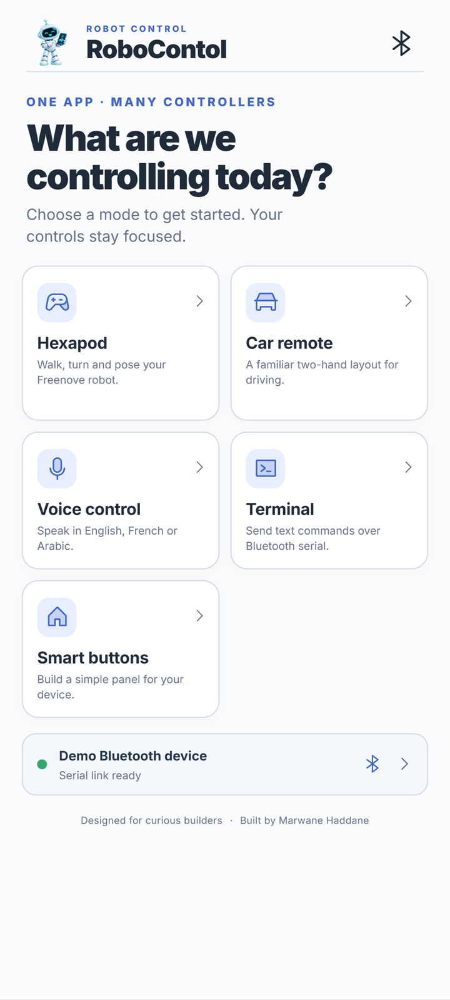<br><b>Pick a controller</b><br><sub>Each mode opens its own focused screen.</sub></td>
    <td width="33%" align="center">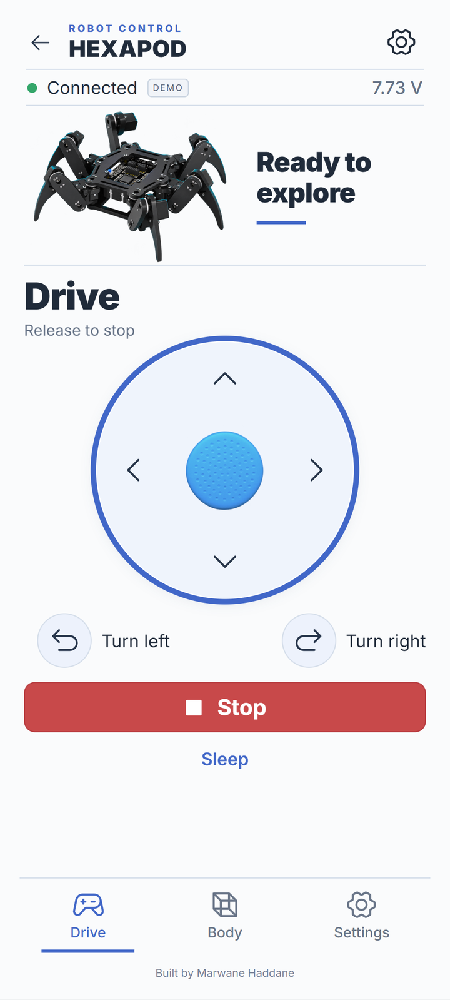<br><b>Hexapod · Drive</b><br><sub>Hold to walk, release to stop. Battery voltage on top.</sub></td>
    <td width="33%" align="center">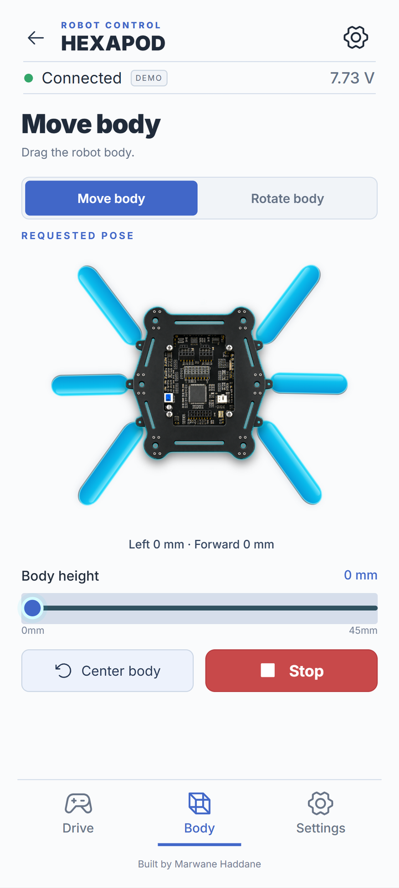<br><b>Hexapod · Body</b><br><sub>Drag the body to shift or tilt it; set its height.</sub></td>
  </tr>
  <tr>
    <td align="center">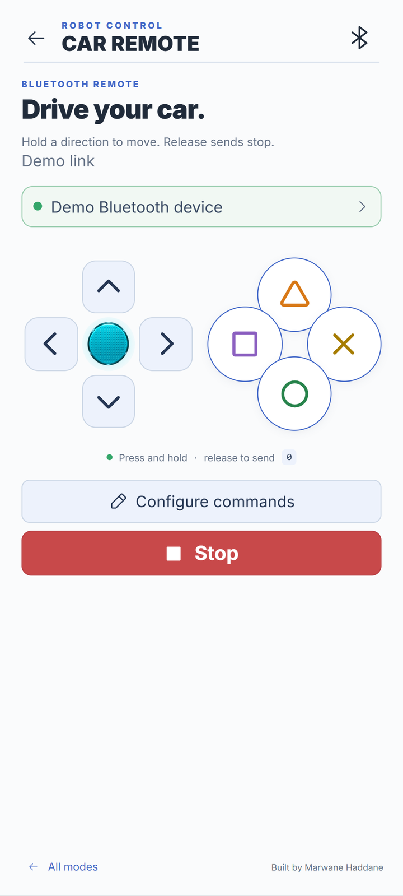<br><b>Car remote</b><br><sub>D-pad plus △ ○ ✕ □ — bind each to any text command.</sub></td>
    <td align="center">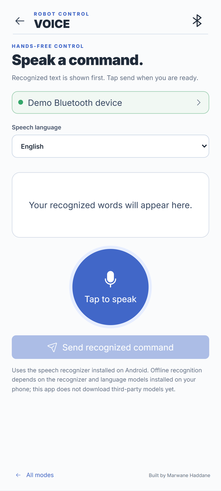<br><b>Voice control</b><br><sub>English, French or Arabic. Review the words, then send them.</sub></td>
    <td align="center">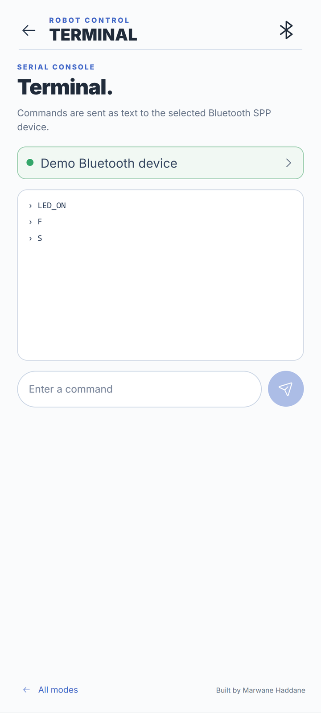<br><b>Terminal</b><br><sub>Send raw text and keep a local history.</sub></td>
  </tr>
  <tr>
    <td align="center">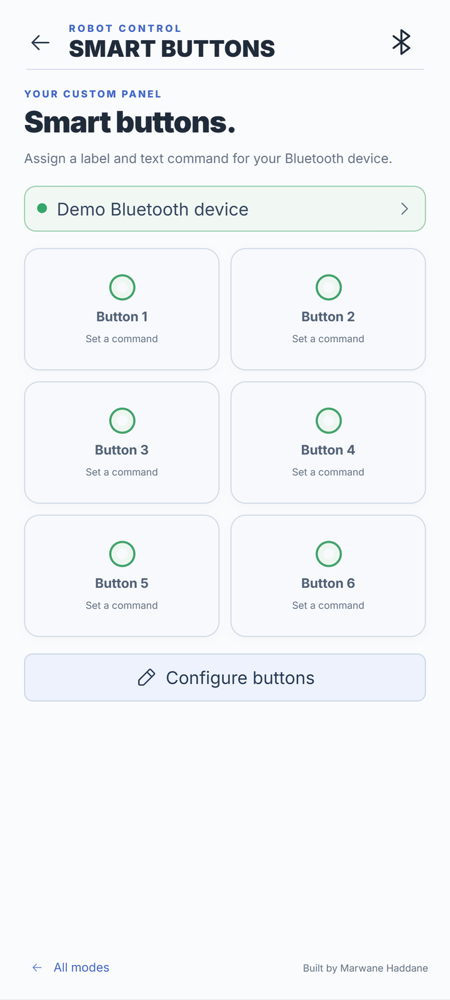<br><b>Smart buttons</b><br><sub>Name six buttons and give each an ON/OFF command.</sub></td>
    <td align="center">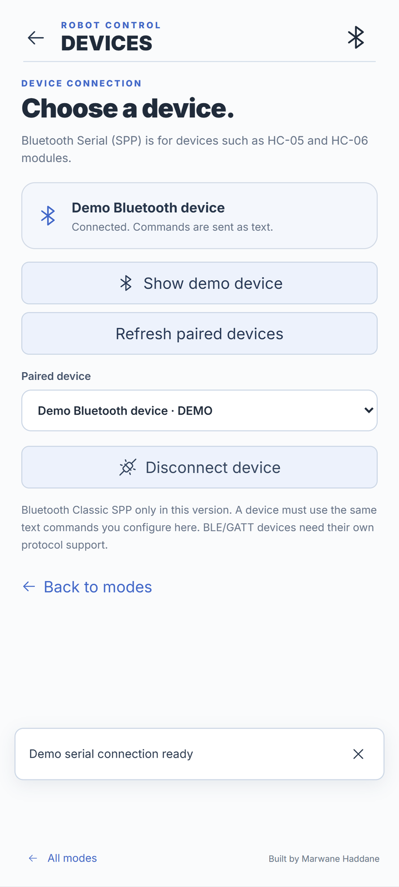<br><b>Devices</b><br><sub>Pick a paired HC-05 / HC-06 style serial module.</sub></td>
    <td align="center">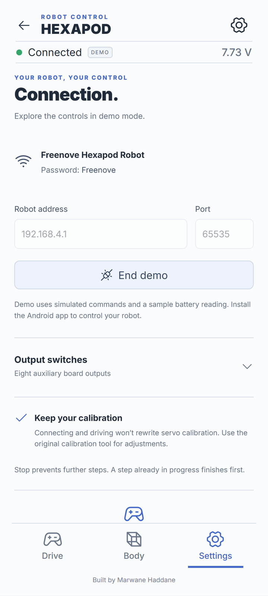<br><b>Hexapod · Settings</b><br><sub>Address, port and eight auxiliary outputs.</sub></td>
  </tr>
</table>

<p align="center">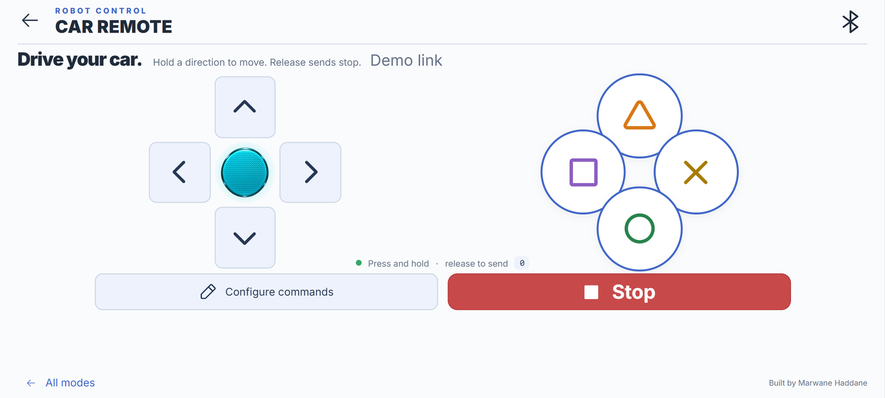</p>
<p align="center"><em>Turn the phone sideways and the car remote becomes a two-thumb gamepad.</em></p>

## What works today

| Controller | Connection | What it does | Current boundary |
| --- | --- | --- | --- |
| **Hexapod** | Robot Wi-Fi, native TCP | Walk, turn, stop future gait requests, sleep/activate, body move/rotate/height, eight auxiliary outputs | Uses the existing Freenove firmware protocol; never touches calibration or firmware |
| **Car remote** | Bluetooth Classic SPP | Landscape-ready D-pad and four face buttons; release sends stop | You bind each button to the text command your firmware expects |
| **Voice** | Android speech service → selected device | English, French, Moroccan Arabic or Arabic; the recognized words are shown, then sent as a text command when you tap send | Your device must understand the spoken words as commands; offline recognition depends on the phone's speech service and language packs |
| **Terminal** | Bluetooth Classic SPP | Send text and see the local send/receive log | Plain text only |
| **Smart buttons** | Bluetooth Classic SPP | Six named buttons with configurable ON/OFF commands | For devices that accept text commands |

Bluetooth support targets **paired Bluetooth Classic serial devices** (SPP profile, UUID `00001101-…`), such as HC-05/HC-06 modules or an ESP32 running `BluetoothSerial`. BLE/GATT-only devices and proprietary protocols need a device-specific integration and are not plug-and-play.

## Connect to the Freenove hexapod

1. Power on the calibrated robot and join its **Freenove Hexapod Robot** Wi-Fi from Android (default password **Freenove**).
2. If Android warns that the network has no internet, choose to **stay connected**.
3. In RoboContol, open **Hexapod → Settings** and connect. Defaults: address `192.168.4.1`, port `65535`.
4. Go back to **Drive**. Hold a direction to walk; release to stop sending movement.

The firmware finishes a gait cycle before it accepts the next command, so **Stop cancels future steps — it is not a motor power cut.** Verify movement with the robot on a clear surface first.

## How it works

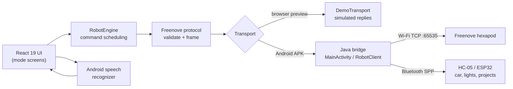

| Layer | Responsibility | Source |
| --- | --- | --- |
| Mode screens | Home, hexapod, car, voice, terminal, smart buttons, devices | [`src/native.tsx`](src/native.tsx) · [`src/mobile/`](src/mobile) |
| Robot engine | Hold-to-walk, release handling, coalescing body updates, reconnect safety | [`src/robot/engine.ts`](src/robot/engine.ts) |
| Protocol | Freenove V12.6 order codes, payload validation, binary framing | [`src/robot/protocol.ts`](src/robot/protocol.ts) |
| Leg preview | Live six-leg body pose drawn from the requested axes | [`src/robot/rig.ts`](src/robot/rig.ts) · [`src/RobotRig.tsx`](src/RobotRig.tsx) |
| Transports | `DemoTransport` for the browser, `AndroidTransport` for the native bridge | [`src/robot/transport.ts`](src/robot/transport.ts) |
| Android host | WebView host, Wi-Fi-bound TCP socket, Bluetooth SPP socket and reader | [`android/app/src/main/java/dev/marwane/hexapod/`](android/app/src/main/java/dev/marwane/hexapod) |

### Hexapod protocol, briefly

Commands follow the Freenove V12.6 order table (for example `Forward = 80`, `Crawl = 110`, `Height = 112`, `Move = 114`, `Rotate = 116`). Every payload is **validated before it can reach a transport** — wrong length, non-integer or out-of-range bytes throw — then framed as:

```
0x80  <order> <args…>  0x81        args are 0–127; signed values are sent as 64 + offset
```

Joystick input is clamped to the firmware's limits (±42 for crawl, ±18 for turn, 0–45 mm for body height) before encoding.

### Designed to fail safe

| Situation | What the engine does |
| --- | --- |
| You release the joystick | Further walking is discarded; a blocking command is never overlapped |
| You drag the body slider quickly | Updates coalesce to the latest pose instead of replaying a backlog |
| The connection drops | Motion stops and is **never replayed** after reconnecting |
| Settings are invalid (bad IP or port) | They are rejected before reaching the transport |

Each row is covered by a test in [`tests/robot.test.ts`](tests/robot.test.ts).

## Build from source

**Requirements:** Node.js 22+, JDK 17, Android SDK 36, and an Android 8 (API 26)+ phone.

```powershell
npm ci
npm run check:runtime
npm run build:android-ui
cd android
.\gradlew.bat assembleDebug
```

The APK is written to `android/app/build/outputs/apk/debug/app-debug.apk`. A Windows helper is also available at [`scripts/build-android.ps1`](scripts/build-android.ps1).

### Run the browser preview

```powershell
npm ci
npm run dev -- --port 4173
```

Open `http://localhost:4173/native.html` for the exact app UI, or `/` for the phone-frame prototype. The preview uses **demo transport**: browsers cannot open raw TCP or Bluetooth SPP sockets, so real connections need the APK.

### Publish a release

Pushing a version tag builds and publishes the APK automatically:

```bash
git tag v1.5.2
git push origin v1.5.2
```

[`android-release.yml`](.github/workflows/android-release.yml) builds the web bundle, assembles the APK and attaches `RoboContol-1.5.2-android.apk` to a new GitHub release with generated notes.

## Verification

```bash
npm test             # 7 protocol and engine tests (Node test runner)
npm run test:runtime # Playwright tests for the mobile UI runtime
npm run build        # type-check and production build
```

The protocol tests check Freenove binary framing and signed offsets, the body-pad axis mapping, the leg preview geometry, and the four fail-safe behaviours above. `tests/NativeProtocolTest.java` covers the Java side of the bridge. Physical robots, Bluetooth modules and speech recognition still need testing on your own hardware — no device was connected while building the app.

## Project layout

| Path | Contents |
| --- | --- |
| `src/` | Mode screens, controller logic and robot protocol |
| `android/` | Android host app and native Wi-Fi/Bluetooth bridges |
| `public/assets/` | Mascot, robot illustrations and icons |
| `scripts/` | Runtime checks and Android asset/build helpers |
| `tests/` | Protocol, engine, runtime and native bridge tests |
| `docs/` | Design references, asset notes and README screenshots |

## Safety and compatibility

RoboContol sends commands to physical devices. Confirm the selected device and its command mapping before moving anything, and keep a hand near the robot's power switch. The hexapod mode leaves your firmware and servo calibration unchanged. Behaviour depends on the connected hardware, its firmware, Android permissions (Bluetooth, microphone, network) and the installed speech service.

## Credits and license

- Hexapod protocol and firmware references: [Freenove](https://github.com/Freenove) — see [FREENOVE-LICENSE.txt](FREENOVE-LICENSE.txt).
- App source: [MIT License](LICENSE). Bundled third-party assets and dependencies keep their own terms.

---

<p align="center">Built by <strong>Marwane Haddane</strong> · <a href="https://github.com/Marwane-Haddane">GitHub</a></p>
